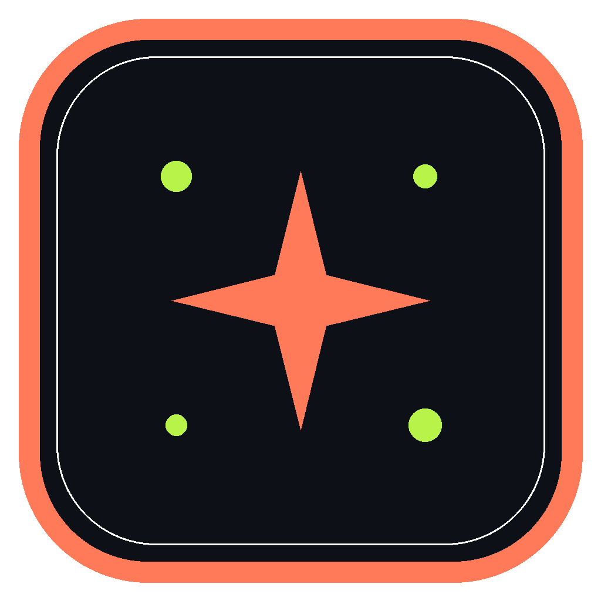
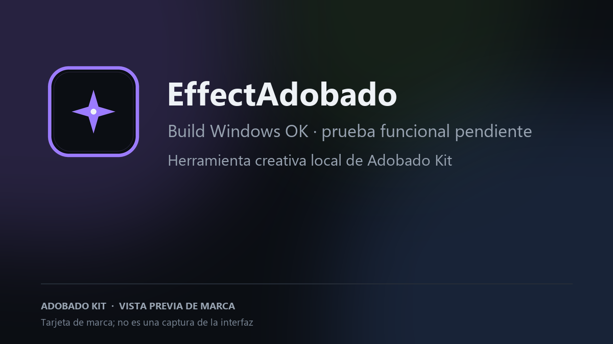

# EffectAdobado

**Efectos visuales locales.** Derivado de EffectCraft, rebrandeado para Adobado Kit.

> **Build de Windows correcta (20/10/2026).** Falta instalar e iniciar la app manualmente. La prueba de abrir, modificar y exportar un archivo real también está pendiente. La imagen siguiente es una tarjeta de marca, no una captura de la interfaz.
>
> Proyecto independiente. No afiliado a ArtCraft ni a Adobe.

Tarjeta de marca; no es una captura de la interfaz.

## Estado

- **Build de Windows:** correcto en GitHub Actions; consulta el [workflow actual](https://github.com/smouj/EffectAdobado/actions/workflows/windows-build.yml).
- **Prueba manual:** instalación e inicio pendientes.
- **Flujo funcional:** abrir, modificar y exportar un archivo real sigue pendiente.
- **Disponibilidad:** alpha; todavía no se declara lista para uso general.
- **Release pública:** todavía no existe. No se publica un binario hasta completar las pruebas.
- **Commit de origen:** ef74d82902ba486891b02afa87e42963cc9b84cc.

## Build

Requisitos: Rust 1.95 o superior.

    cargo build --release -p effectcraft

El nombre interno del crate se conserva para no romper el workspace; el nombre de producto visible es EffectAdobado.

## Procedencia y licencias

- Upstream: https://github.com/storytold/effectcraft
- Commit base: ef74d82902ba486891b02afa87e42963cc9b84cc
- Licencia: MIT OR Apache-2.0. Se conservan los archivos de licencia, NOTICE y ATTRIBUTION del upstream.
- Cambios: docs/ADOBADO.md.
- La marca, el wordmark y los logos de ArtCraft no estan cubiertos por la licencia y se retiran de la distribucion.

## Adobado Kit

Este repo forma parte de Adobado Kit: https://github.com/smouj/Adobado_Kit

Hecho por SMOUJ013.
